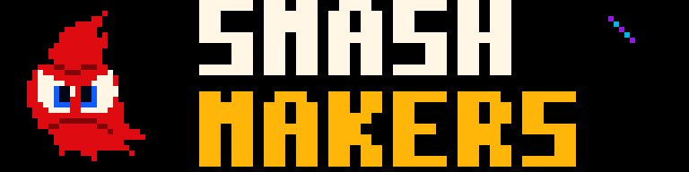
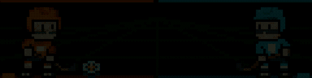
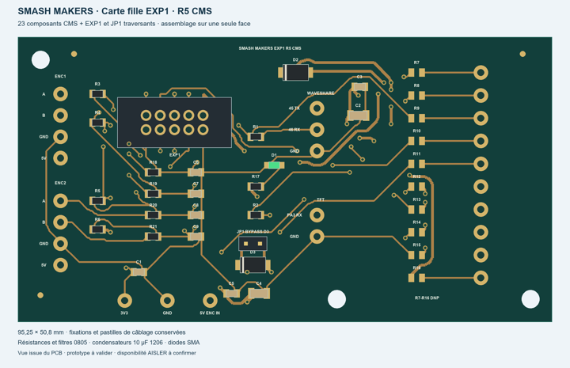

# 🎮 Smash-Makers

**Un jeu d'arcade électromécanique imaginé par un grand enfant… qui a grandi sans perdre l'envie de jouer.** ❤️

**Projet V15 — 18 novembre 2026** · *Prototype en développement*

**Créateur, concepteur et développeur : Cédric Boboch**

Smash-Makers mêle la passion du jeu d'arcade, la mécanique motorisée, l'impression 3D, l'électronique et les animations LED. Deux raquettes mobiles, une balle guidée, des moteurs pas à pas et deux matrices RGB transforment une idée de gamin en machine bien réelle.

> 🔒 **Ce dépôt est une vitrine du projet : aucun code source, aucun firmware, aucun fichier de flashage.**
>
> 🧪 **État du projet :** les validations logicielles documentées ne remplacent pas les essais physiques de la V15 complète.

## ❤️ L'histoire du grand enfant derrière la machine

Il paraît qu'en grandissant, on range ses jouets et on devient sérieux…

Eh bien, moi, j'ai dû rater cette étape ! 😁

Je suis adulte, avec les responsabilités qui vont avec. Mais au fond, je suis toujours ce gamin qui s'émerveillait devant les bornes d'arcade, qui voulait comprendre comment les choses fonctionnaient et qui rêvait de construire ses propres machines.

La différence, c'est qu'aujourd'hui, mes jouets ont changé : à la place des petites voitures, je m'amuse avec des moteurs, des courroies, des imprimantes 3D, des cartes électroniques et des matrices LED.

**Je ne me contente plus de jouer aux jeux des autres… je crée les miens !**

Un projet, ce sont des heures à imaginer, dessiner, assembler, tester, parfois recommencer. Et puis une animation s'allume, un mécanisme fonctionne enfin, et le sourire du gamin revient.

**Grandir, oui. Arrêter de rêver et de jouer ? Jamais !** ❤️

➡️ [Lire mon histoire complète](documentation/LE_GRAND_ENFANT_DERRIERE_SMASH_MAKERS.md)

## 🕹️ Trois univers de jeu

### 1. Smash Makers — Pong à sets

Le classique revisité en version mécanique :
- Parties à **11 points**, avec **2 points d'écart**.
- Victoire en **2 sets gagnants**.
- Jeu à un ou deux joueurs.

### 2. Smash Hockey — Match chronométré

Une ambiance hockey avec **3 minutes de temps de jeu actif**, engagements, tirs, parades, buts, scores et animations des personnages.

### 3. Strange Makers — Ambiance fantastique

Une introduction audiovisuelle d'environ **53,48 secondes**, une horloge et un événement qui provoque une **inversion des commandes pendant 8 secondes**.

[Aperçu vidéo de l'horloge sans musique](media/videos/Strange_Makers_Horloge_V15_sans_audio.mp4). Cet extrait ne montre pas l'introduction complète.

Les trois univers disposent d'animations matricielles distinctes dans la V15. Les trois GIF ci-dessus sont disponibles, mais **l'introduction longue de Strange Makers reste volontairement non publiée** (droits sur les personnages et la musique à vérifier).

> 🎞️ Les GIF affichés sont des aperçus des ressources V15, pas des captures filmées d'une matrice physique.

## ⚙️ Principe mécanique

Smash-Makers est un jeu d'arcade électromécanique avec des raquettes et une balle pilotées par des moteurs. **Cédric Boboch indique avoir entièrement repris et redessiné la conception mécanique actuelle de A à Z.** Les plans mécaniques détaillés de cette version ne sont pas encore remis en ligne.

## 🌈 Matrices LED et électronique

- **Deux matrices LED HUB75 P2.5 de 64 × 32**, disposées horizontalement : affichage **128 × 32 pixels**.
- **BTT SKR Mini E3 V3** pour la commande mécanique.
- **Waveshare ESP32-S3 RGB Matrix** pour les animations et l'audio.
- Communication entre les deux cartes par liaison série **UART**.
- **Carte fille EXP1 R5 CMS**, avec documentation du choix d'alimentation JP1 et de la correction D2.

## 📚 Documentation et partage

- [Histoire du projet](documentation/LE_GRAND_ENFANT_DERRIERE_SMASH_MAKERS.md)
- [État du projet et matériel](documentation/PRESENTATION_V15.md)
- [Règles de partage et fichiers exclus](documentation/CONTENU_ET_EXCLUSIONS.md)
- [Droits et précautions](documentation/DROITS_ET_PRECAUTIONS.md)
- [Auteur et crédits](AUTEUR_ET_CREDITS.md)

Les **trois GIF de démonstration**, la vidéo de l'horloge, les aperçus électroniques et les fichiers de fabrication de la carte fille R5 sont accessibles ici. Les plans de la version mécanique actuelle restent à remettre en ligne après vérification des fichiers.

## 📐 Fichiers de la carte fille R5

Les premiers fichiers de fabrication sont maintenant en ligne :
- [Dossier de la carte EXP1 R5](electronique/carte-fille-exp1-r5/)
- [Archive KiCad/Gerber CMS](electronique/carte-fille-exp1-r5/CARTE_EXP1_R5_KICAD_GERBER_CMS.zip)

Les autres médias et les fichiers STEP/STL de la version mécanique actuelle ne sont pas tous publiés. Aucun firmware ni code source n'est inclus.

## 🔒 Code et firmware privés

Ne sont **pas** distribués : programmes Arduino/C/C++/Python, scripts, projets de compilation, binaires `.bin`, `.hex`, `.elf`, `.uf2`, images de flash, clés ou fichiers sensibles.

Les ressources graphiques et sonores ne sont pas des firmwares, mais leur publication doit également respecter les droits d'auteur.

## ⚖️ Crédits et droits

**Smash-Makers est le projet de Cédric Boboch.**

**© 2026 Cédric Boboch — Création, conception et développement de Smash-Makers.** Tous droits réservés pour ses créations originales non placées sous une licence explicite. Les composants, musiques, personnages ou documents provenant de tiers conservent leurs licences et droits respectifs. Ce dépôt ne donne pas d'autorisation générale de redistribution d'œuvres tierces.

---

*« Imaginé avec un cœur d'enfant, construit avec des mains d'adulte, développé avec une passion sans limites. »* ❤️
